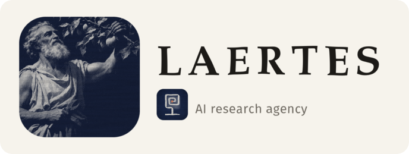
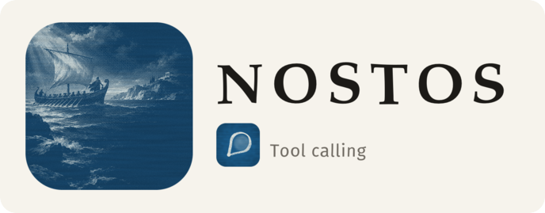
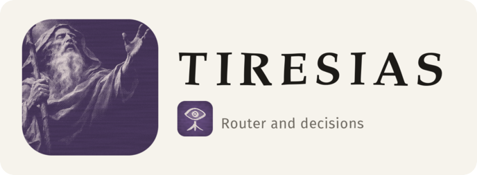
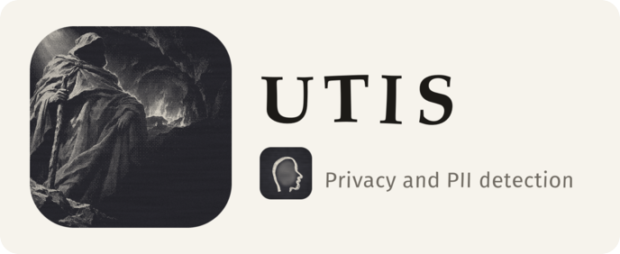

# Laertes

Laertes is an AI research agency. It builds a coding agent for the terminal and plans eight small model families,
each for one job.

State on 2026-11-24: the harness Penelope runs in version 0.10.0. None of the eight model families is trained yet, so
no benchmark result and no model file exists.

## Products

| Name | What it is | State |
|---|---|---|
| [Penelope](https://github.com/LaertesAI/Penelope) | A coding agent for the terminal, written in Rust. Searches and long tool output go to a cheaper model. A filter masks secrets before any model reads them. | public, version 0.10.0, alpha, MIT |
| ScreenCodec MCP | An MCP server that hands a web browser to a model as text. No screenshot reaches the model. | private, not published |
| Panto Engine | The training engine: one loop with six stages from data to an error report. | plan, no code yet |

Numbers that are measured:

| Product | What | Number |
|---|---|---|
| Penelope | Output of `cargo tree` that reached the main model | 168 of 6,947 characters, 1 run |
| Penelope | Tokens of searching in one request | 12,218 on Claude Haiku, 8,669 on Claude Sonnet, 1 run |
| Penelope | Tests | 39 passed, no model call |
| ScreenCodec MCP | Tokens per page in level `lean` | 224, against 1,105 to 2,691 for one screenshot |
| ScreenCodec MCP | Prompt injection attacks that succeeded after the click check | 0 of 96 |

The Penelope numbers come from its README, where the run behind each one is named. The ScreenCodec numbers come from its own test runs.

## Model families

Every family has one job. Penelope already has a place for each of them, and a stand-in works there today.

| Family and job | Today in Penelope | Model |
|---|---|---|
|  | a cheaper model runs lookups as scout | training data in work, no trained model |
|  | fixed rules | planned |
|  | fixed rules for keys, passwords and tokens | planned |
|  | a cheaper model condenses long tool output | planned |
|  | not in use | planned |
|  | not in use | planned |
|  | the main model | planned |
|  | not in use | planned |

Every family is planned in three sizes: `[Family] [Version] Mini`, `[Family] [Version]` and `[Family] [Version] Pro`.
The first training runs happen on one PC with 6 GB of graphics memory.

## Research

Four questions from November 2026. Each row names what was measured or calculated and what stays open. The papers and
prototypes are private.

| Question | Finding | Open |
|---|---|---|
| Can a model read a screen without a vision model? | ScreenCodec writes the screen as text: 474 tokens for a full frame, 10 to 40 tokens for a change. At 2 frames per second a context of 200,000 tokens lasts 59 minutes. With pictures it lasts 37 to 110 seconds. In a blind test with 55 questions the text reached 95.5 percent and pictures 99.1 percent. | The 8 test sequences were synthetic. On 2 new web pages the precision of the detection fell to 0.68. Real desktops are untested. |
| Can a text model hear music? | HörSchrift writes audio as text with classic signal processing: key, chords, melody, bass, drums and events with their time. It costs 31 tokens per second in the median. A text model answered 44 fact questions 92.0 percent right. A control without input reached 58.0 percent. | The audio, the codec and the questions came from one hand. No comparison with an audio model exists. |
| Can 120 trillion parameters run on one PC? | A dense model of that size reads 62 TB per token. That takes 37 minutes per token on a gaming PC of 2026. The design Tiered Sparse Giant reads 2.1 MB from the SSD per token and reaches 3.4 to 7.8 tokens per second by calculation. | No such model is trained. The quality is unmeasured, because 75 percent of the parameters lie in lookup tables. |
| Which hardware beats the memory limit? | At batch 1 a language model computes 1 to 4 operations per byte it reads. A GPU needs 117 to 1,174 operations per byte for full load, so its arithmetic units stand idle over 96 percent of the time. Of 7 hardware classes none gives a single user more bandwidth per dollar than a GPU in 2026. | The own design ROSA wins by calculation only, and only for models of 128 to 512 GB. |

All four questions end at the same limit: the bytes a machine moves per token. That limit is the reason for small
models with one job each.

## Rules for every number

1. A result names its run: the model, the test set, the script, the hardware, the date and the seed.
2. A test set is written before the training data and never used for training.
3. A planned target is marked as planned. It never stands in a results table.
4. A result from one run and one seed says so.
5. Training data comes only from models whose licence allows training on their output.

## Names

Every name comes from the Odyssey. Laertes is the father of Odysseus, and Penelope weaves his shroud. Nostos is the
journey home, Tiresias the blind seer, Utis the name "Nobody" that Odysseus gives the Cyclops. Aiolos keeps the winds
in a sack, Argos is the dog that knows its master, and Klea is short for Eurykleia, who knows the scar. Telemach is
the son who fits out a ship. Proteus is the sea god who changes shape.

## Take part

- A bug or an idea for Penelope goes to its [issues](https://github.com/LaertesAI/Penelope/issues).
- [CONTRIBUTING.md](https://github.com/LaertesAI/.github/blob/main/CONTRIBUTING.md) says what a change needs.
- [SECURITY.md](https://github.com/LaertesAI/.github/blob/main/SECURITY.md) says how to report a weakness in private.
