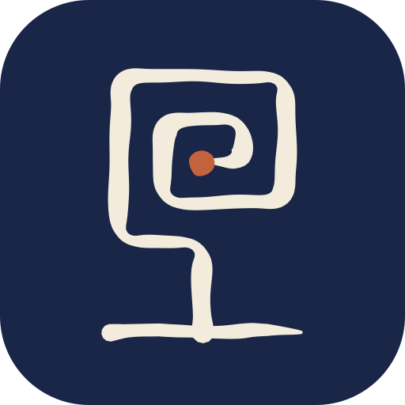

# Laertes

Laertes is an AI research agency. It plans eight small model families, each for one job, and builds the harness they
run in. The names come from the Odyssey: Laertes is the father of Odysseus, and Penelope weaves his shroud.

State on 2026-11-24: the harness runs in version 0.9.0. None of the eight model families is trained yet, so there is
no benchmark result and no model file.

| Name | Job | State |
|---|---|---|
| [Penelope](https://github.com/LaertesAI/Penelope) | command line harness in Rust | public, version 0.9.0 |
| Nostos | tool calling | first training runs |
| Tiresias | router and decisions | planned |
| Utis | privacy and PII detection | fixed rules inside Penelope, model planned |
| Aiolos | compression and summaries | planned |
| Argos | judge and scoring | planned |
| Klea | data filter | planned |
| Telemach | coding and agents | planned |
| Proteus | ML engineering and MoE conversion | planned |

Every family is planned in three sizes: Mini, base and Pro. The first plans start on one PC with an RTX 3050 and 6 GB.
